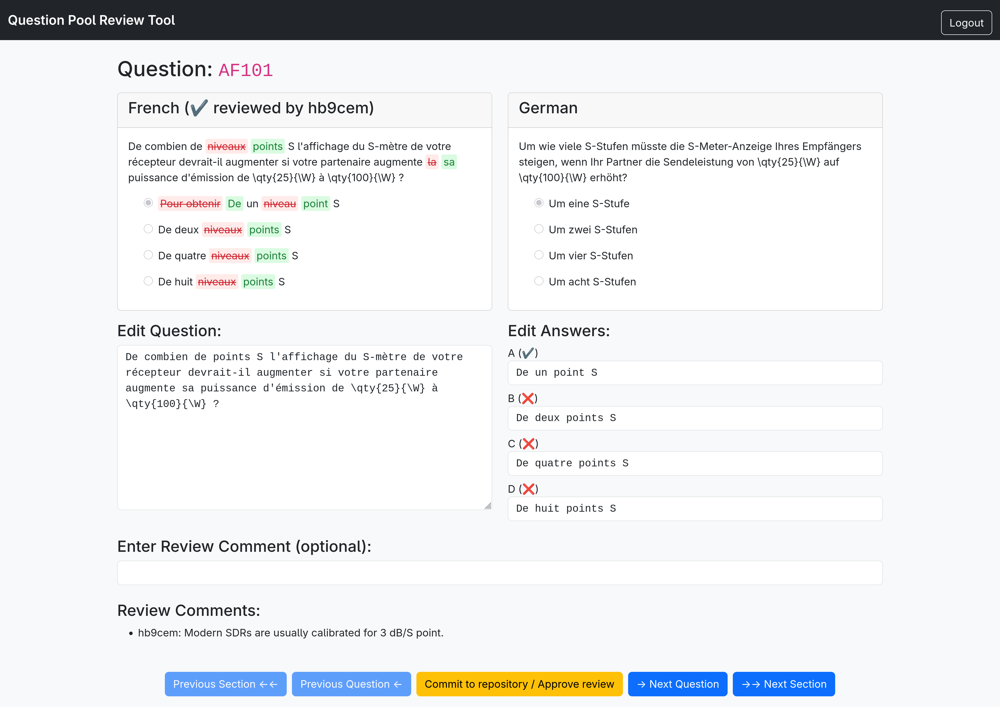

# 50ohm Pool Question Review Tool

## Overview
This tool is part of the Swiss 50ohm platform and is used to review the question pool for the platform. it is used for reviewing the French and Italian translations of the original question pool as well as any changes that need to be applied to the German version. The application is a web-based tool built with FastAPI and runs serverless on Google Cloud Run.



## How it works
Users authenticate with their GitHub account, and the resulting OAuth2 token allows the application to retrieve questions and push changes to the repository containing the source data. The repository is defined in a `.env` file, with an example provided as `.env.example`.

Each question is stored in its own JSON file, and review comments are logged in the `HB.comments` field of the corresponding JSON. The `WIP` branch contains the latest version with all ongoing changes, which are always compared to the commit tagged `FR_orig_DeepL`. Original questions in German are taken from the commit `german_orig`. The `fragenkatalog3b.json` file is used for creating the table of contents; questions in this file are not used as they do not represent the latest state of our process.

Through the web interface, users can view questions, add review comments, and submit updates back to the repository.

## Deployment
A new container image is built and deployed automatically when changes are merged into the `deploy` branch, making deployment to Google Cloud Run seamless. To run the tool locally, you need to install the requirements as listed in `requirements.txt` and create a `.env` file based on `.env.example` where you provide the required environment variables.

## Local Docker baseline

The local GitHub OAuth application must use:

- homepage URL: `http://localhost:8080`
- callback URL: `http://localhost:8080/auth/callback`

Keep secrets outside the repository, for example in
`~/.config/50ohm-review-tool/local.env`. Build and start the local baseline with:

```bash
docker build --tag 50ohm-question-review-tool:campaign-readonly .

docker run --rm --detach \
  --name 50ohm-question-review-local \
  --publish 127.0.0.1:8080:8080 \
  --env-file ~/.config/50ohm-review-tool/local.env \
  --env GITHUB_OWNER=isqsoft \
  --env GITHUB_REPO=50ohm-question-review-campaigns \
  --env CAMPAIGN_BRANCH=campaign/fr-empfaenger-sinus-signals-example \
  --env GITHUB_CALLBACK_URL=http://localhost:8080/auth/callback \
  --env SESSION_HTTPS_ONLY=false \
  50ohm-question-review-tool:campaign-readonly
```

The server is then available at `http://localhost:8080`. Its health endpoint
is `http://localhost:8080/healthz`.

The current campaign integration is deliberately read-only. It reads the
German-French campaign and its derived table of contents directly through the
GitHub API. The save route returns HTTP 405 until campaign writes are
implemented explicitly.

After GitHub login, the interface reads `languages` and `editable_languages`
from `campaign.meta.json`. The reference and review languages are selected in
the table-of-contents page and carried through every navigation link. They must
be distinct, and only a language listed in `editable_languages` can be selected
for review. The current example campaign therefore offers German as reference
and French as review language.

For a private organization repository, the OAuth application must be granted
access to that organization. Otherwise authentication succeeds but campaign
reads return HTTP 403.
